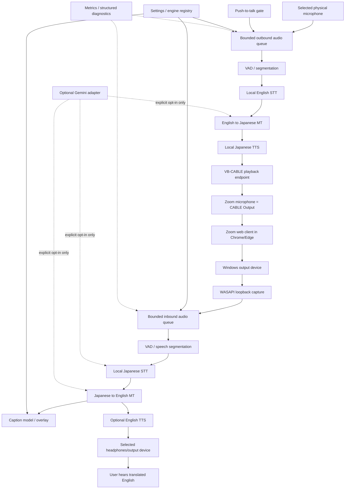

# SPEC.md — Real-Time Japanese ↔ English Meeting Translator

**Status:** Architecture baseline approved; implementation must not begin beyond discovery/prototype work until the license and hardware gates in this specification are satisfied.  
**Last reviewed:** 2026-10-13  
**Repository license target:** MIT for project-owned code.  
**Primary target:** Windows 10/11 x64, plugged-in laptop, Intel Core i7-8750H, 32 GB RAM.  
**Product:** Personal, open-source desktop translator for Zoom meetings joined in Chrome/Edge.  
**Owner's priorities:** Balanced latency and understandable translation; local-first; local Japanese TTS required; cloud strictly opt-in; permissive licenses preferred; user installs VB-CABLE from the official source.

---

## 1. Executive decision

Build a **local-first, CPU-oriented desktop application** with independently scheduled inbound and outbound audio pipelines. Deliver in stages, starting with reliable device capture and inbound captions. Add local Japanese TTS and outbound injection only after routing, quality, license, and resource tests pass.

Do not promise a fixed real-time latency before collecting measurements on the target laptop. The i7-8750H/32 GB RAM is a plausible test platform for small quantized CPU models, but no performance conclusion is approved until measured. The reported immediate shutdown when unplugging the charger, and prior shutdown during a demanding game, is a separate hardware/power stability concern. Do not benchmark unplugged; recommend diagnosing battery/power/thermal problems separately. This project must not be used as a stress test on a machine that shuts down unexpectedly.

### Non-negotiable constraints

- Windows desktop application; Windows 10/11 x64 target.
- No Zoom APIs or SDKs. Capture and inject audio through Windows audio devices only.
- Free to use for the user; no paid API, subscription, or mandatory paid dependency. Donations are acceptable but not required.
- Local mode sends no audio or transcript content over the network. Model downloads are explicit setup actions, not runtime telemetry.
- Cloud mode is optional and requires explicit opt-in each time it is enabled or first configured. It must clearly disclose what data is sent and that free-tier content may be used to improve Google's products.
- No secrets in source control, logs, crash reports, screenshots, or benchmark artifacts.
- Project-owned code is MIT. Use permissively licensed dependencies and assets where possible. Do not bundle a copyleft or restricted model/voice unless the owner explicitly approves an exception after reviewing its obligations.
- No invented benchmark claims. CPU, memory, stage latency, end-to-end latency, and test conditions must be measured and reported.
- User installs VB-CABLE from the official site; the application does not bundle or silently install it.
- The application must fail visibly and safely; never silently switch to a cloud service or silently lose audio.

## 2. Scope

### In scope for MVP

1. Desktop GUI with device selection and clear pipeline status.
2. WASAPI loopback capture of a user-selected output device used by the browser/Zoom web client.
3. Local Japanese speech recognition and Japanese-to-English translation.
4. English captions with timestamps and status; optional local English speech output.
5. Local English-to-Japanese translation and Japanese TTS, routed to the selected virtual cable.
6. Push-to-talk outbound mode with a configurable global hotkey; VAD-based always-on mode is secondary.
7. Explicitly configured input/output devices, including VB-CABLE.
8. Caption overlay, glossary, local transcript export when enabled, settings persistence.
9. Optional Gemini cloud mode behind an interface, only after current free-tier availability, API behavior, privacy, and quota handling are verified. It must not be required for MVP operation.
10. Reproducible tests, CI, dependency/model license inventory, Windows packaging, and evidence-based README.

### Out of scope for MVP

- Zoom APIs, SDKs, browser extensions, browser injection, or meeting-bot behavior.
- Guaranteed word-level simultaneous interpretation or zero-delay speech.
- Speaker diarization, speaker identity, emotion detection, or automatic language identification beyond what the selected engine reliably supports.
- Automatic system-wide audio routing changes without user confirmation.
- Per-application volume control and automatic ducking. These are optional later investigations.
- Automatic mixing of original English into the virtual cable. Default off; defer implementation until the translated-only route is stable.
- Automatic installation of drivers, unattended elevation, or bundling third-party audio drivers.
- Cloud as an automatic fallback when the user selected Local mode.
- Claiming a “low CPU” or “real-time” rating without measured evidence.

## 3. User stories

- As a user, I can select the device that plays Zoom audio and see a live input-level indicator before enabling translation.
- As a user, I can hear Zoom normally while seeing English captions translated from Japanese.
- As a user, I can optionally hear translated English through a separately selected output device.
- As a user, I can hold a global push-to-talk hotkey, speak English, and have Japanese speech sent to the configured virtual cable.
- As a user, I can see which pipeline is active, its latest latency, CPU/RAM readings, and errors.
- As a user, I can use local mode without audio or transcripts leaving my machine.
- As a user, I can explicitly opt into cloud mode and understand the data/privacy trade-off.
- As a user, I can disable transcript persistence and delete locally stored transcripts and settings.
- As a user, I can tell when the model, microphone, output device, cable, or cloud service is unavailable.

## 4. Architecture

### 4.1 Logical diagram

### 4.2 Core design rules

- Keep capture callbacks minimal: copy frames into bounded queues and return. Never run STT/MT/TTS on the audio callback thread.
- Separate capture, inference, translation, TTS, GUI, and metrics work. Use bounded queues, cancellation, timeouts, and explicit backpressure behavior.
- Maintain independent inbound and outbound scheduling. Start with one inference worker per expensive model; concurrency limits must be measured.
- Model loading is lazy and reports progress. Preload only the models required by enabled directions and selected preset.
- Each pipeline stage has an interface and structured timing: `AudioCapture`, `VadEngine`, `SttEngine`, `TranslateEngine`, `TtsEngine`, `AudioOutput`.
- Every output chunk carries a pipeline/session ID, timestamps, source, and suppression metadata so stale results can be discarded safely.
- No silent language or engine substitution. A failed stage marks the affected pipeline degraded and surfaces a clear error.
- Local mode must not instantiate a cloud client or send any application data over the network. Model download endpoints may be contacted only during explicit model installation/update.
- Do not persist raw audio by default. Transcript saving is opt-in.
- Settings are versioned JSON in the user's local application-data directory, not in the repository. Secrets use Windows Credential Manager through a vetted keyring integration, not plaintext config.
- Never store API keys in `.env` committed to Git, screenshots, test fixtures, logs, or crash dumps.

### 4.3 Audio routing and feedback prevention

1. User selects a **loopback source** and a **translated-audio output** explicitly. Prefer headphones and an output device distinct from the one being loopback-captured.
2. Inbound loopback captures all audio rendered to that endpoint, not necessarily Zoom alone. Document this limitation. Do not claim application-specific capture.
3. Prefer sending inbound translated English to a separate headphone/output endpoint that is not the loopback source.
4. Outbound Japanese TTS is sent only to the VB-CABLE playback endpoint (usually shown as **CABLE Input**). In Zoom, the microphone/recording endpoint is usually **CABLE Output**. The wizard must show device names as Windows reports them and ask the user to verify with a test recording.
5. Keep the physical microphone as the outbound capture source. The app must not capture the cable's recording endpoint as the microphone input.
6. Add a suppression guard for app-generated audio and a short configurable post-TTS suppression window only as a secondary defense. This is not a substitute for correct device separation.
7. The wizard checks for acoustic leakage by asking the user to play translated audio while monitoring the physical mic input. Recommend headphones; warn that speakers can cause acoustic feedback.
8. If the user chooses the same loopback and translated output device, show a warning and require confirmation. The app should not pretend this route is echo-proof.
9. If a device disappears, stop that pipeline safely, preserve settings, display an actionable error, and do not silently redirect audio to a different device.
10. Original English voice mixing into the cable is excluded from MVP. If added later, it must be explicit, independently level-controlled, and tested for feedback.

## 5. Engine decisions and license gates

**License policy:** permissive-first means MIT/BSD/Apache-style dependencies and model assets are preferred. LGPL is not automatically “permissive” for this project; GPL-only components are excluded unless the owner explicitly changes the policy. The code license of a runtime does not establish the license of its weights, voices, phonemizer data, or bundled binaries.

| Stage | Preferred candidate | License/compatibility status | Decision and rationale |
|---|---|---|---|
| VAD | Silero VAD, preferably ONNX Runtime path if integration tests pass | Silero VAD repository says MIT; verify exact model and dependency versions at lock time. [Official repository](https://github.com/snakers4/silero-vad) | **Selected candidate.** Speech gating can reduce unnecessary STT work. Benchmark CPU and false cuts; VAD is not assumed to guarantee lower end-to-end latency. |
| Japanese and English STT | `faster-whisper` with a small model and CPU `int8` as first benchmark candidate | `faster-whisper` code is MIT. Whisper model license and exact model artifact must be recorded separately. [License](https://github.com/SYSTRAN/faster-whisper/blob/master/LICENSE) · [Project](https://github.com/SYSTRAN/faster-whisper) | **Selected candidate.** Established CPU-oriented inference path. Start with a small model; compare `base` only if the measured quality gain justifies resource cost. Not described as streaming until incremental behavior is proven. |
| JA↔EN MT | Argos Translate with direct Japanese↔English packages | Argos code is MIT/CC0; exact downloaded `.argosmodel` package license and source must be verified before use. [Official repository](https://github.com/argosopentech/argos-translate) | **Selected candidate for first evaluation.** Offline and relatively simple integration. Direct model availability, translation quality, package license, and speed are release gates. Do not silently pivot through another language. |
| English TTS | Evaluate a permissively licensed local voice/runtime; select exact voice only after artifact-level license review | Piper's older `rhasspy/piper` repository lists MIT, but the maintained `OHF-Voice/piper1-gpl` package lists GPL-3.0-or-later. This is not approved under the current permissive-only policy. Voice/model licenses are separate. [Older repository](https://github.com/rhasspy/piper) · [Current fork package metadata](https://github.com/OHF-Voice/piper1-gpl/blob/main/setup.py) | **Not yet selected.** Optional English audio must not block captions. Do not assume Piper is MIT merely from older repository history. |
| Japanese TTS | Evaluate Style-Bert-VITS2 or another local engine only with a specifically identified, permissively licensed Japanese voice/model | Runtime and each model/voice/phonemizer asset need separate verification. VOICEVOX Engine is LGPLv3, with additional voice/character terms, so it does not meet the preferred permissive-only policy without explicit exception. [VOICEVOX license](https://github.com/VOICEVOX/voicevox_engine/blob/master/LGPL_LICENSE) | **Mandatory release gate; exact engine/voice not yet approved.** Local Japanese speech is required, but no unverified voice may be shipped or downloaded by default. If no compliant voice passes quality and runtime tests, stop and present compliant candidates for owner approval rather than quietly using a restricted asset. |
| GUI | Tkinter/ttk using Python's standard-library interface, subject to Windows UI prototype validation | Avoids PySide6's LGPLv3/GPLv3/commercial licensing choice. Tcl/Tk runtime notices still need inventory and packaging review. [Python tkinter docs](https://docs.python.org/3/library/tkinter.html) · [PySide6 license reference](https://doc.qt.io/qtforpython-6/) | **Selected initial GUI candidate** to honor permissive-first policy and reduce packaging complexity. If overlay behavior proves insufficient, propose an alternative with a documented license review before replacing it. |
| Audio capture/output | Windows WASAPI via a maintained Python binding; candidate selection after Windows device and redistribution test | Exact binding, native binaries, and license must be inventoried. `soundcard` and `pyaudiowpatch` are candidates, not yet approved. | **Implementation gate.** Prove loopback capture, endpoint enumeration, sample-rate conversion, and stable output on Windows 10/11 before choosing. |
| Cloud adapter | Gemini API via a documented supported SDK or REST/WebSocket implementation | API service terms and pricing are not an open-source software license. Current Gemini pricing docs show free-tier data may be used to improve Google products; availability and quotas vary by model/endpoint. [Official pricing](https://ai.google.dev/gemini-api/docs/pricing) · [Live API docs](https://ai.google.dev/gemini-api/docs/live) | **Optional, disabled by default.** Verify current supported model, audio translation behavior, rate limits, data handling, and key storage before implementation. No paid fallback. |

### 5.1 Engine selection gates

Before pinning an engine/model, add a checked-in `THIRD_PARTY_NOTICES.md` and a machine-readable asset manifest with:

- package/model/voice name and exact version or immutable revision;
- official source URL and download URL;
- software license and separate model/voice/data license;
- attribution and redistribution obligations;
- checksum for downloaded artifacts;
- whether it is bundled or downloaded by the user;
- test status and known limitations.

Do not bundle a model or voice until license and redistribution terms are confirmed from the exact upstream artifact. If an asset's terms are ambiguous, treat it as not approved.

### 5.2 Cloud safety

- Cloud is off by default and only used after explicit user consent.
- UI identifies whether audio or recognized text is being sent.
- No cloud requests in Local mode, including retries and error reporting.
- Store keys in Windows Credential Manager via a maintained keyring package; never log keys.
- On quota/rate-limit/auth/network failure: surface the error, stop cloud requests with bounded backoff, and switch to local only if the user enabled an explicit “fallback to local” setting and local engines are ready. Never switch to cloud from local mode.
- Never promise the free tier is unlimited or permanently available. No paid endpoint or billing-enabling workflow.
- Cloud mode must show a concise warning that provider-side handling differs from local-only mode, including the current official notice about free-tier data use. Recheck the policy when implementing and before release.

## 6. Settings

Settings persist in versioned JSON under the user's application-data directory. Secret material is stored separately in Windows Credential Manager. Settings that require model reload or audio-device restart must show that a restart is needed.

| Setting | Options | Default | Notes |
|---|---|---|---|
| Inbound translation | On / Off | On | Does not disable original Zoom audio. |
| Inbound output | Captions / English audio / Both | Captions | Default avoids loading English TTS until validated. |
| Caption overlay | On / Off | On | Always-on-top; draggable. |
| Overlay click-through | On / Off | Off | Optional; must remain recoverable from main window/tray. |
| Caption languages | English / Japanese / Both | Both | Show original recognized text only when enabled. |
| Font size | Bounded numeric range | 20 px initial | Validate on common Windows DPI scales. |
| Translated-audio volume | 0–100% | 80% | Safer than the draft's 100%; must not alter original Zoom volume. |
| Translated-audio output device | Enumerated endpoints | Explicit user selection | Do not silently pick an endpoint when ambiguity exists. |
| Outbound translation | On / Off | On | User can disable it independently. |
| Outbound activation | Push-to-talk / VAD always-on | Push-to-talk | PTT is MVP default to avoid unintended transmission. |
| PTT hotkey | Configurable global hotkey | Unassigned until setup | Wizard requires a valid, conflict-free binding before outbound use. |
| Raw English mixed into cable | On / Off | Off; disabled in MVP | Setting may be displayed as “not supported yet” until implemented. |
| Language pair | Japanese↔English | Japanese↔English | Other pairs out of MVP. |
| Japanese politeness | Casual / Polite / Formal | Polite | Best effort; quality depends on local MT. Label as guidance, not guarantee. |
| Engine mode | Local / Gemini opt-in | Local | Mixed per-stage mode deferred until tested. |
| Cloud fallback | Off / Local fallback on cloud failure | Off | Never causes local mode to send data to cloud. |
| Quality preset | Light / Balanced / Quality | Balanced | Resource policy; only enable presets with recorded measurements. |
| STT model | Installed supported models | Small candidate | `base` may be offered only after benchmark and model license check. |
| TTS voice | Installed approved voices | First approved Japanese voice | If no compliant voice is approved, Japanese TTS milestone remains blocked. |
| TTS speed | 0.75–1.5× | 1.0× | Only if selected engine supports reliable speed control. |
| Glossary | Source/target term pairs | Empty | Apply to MT only when safe; document case/normalization behavior. |
| Loopback source | Enumerated endpoints | Unset until wizard | Do not assume the default device is Zoom's endpoint. |
| Physical microphone | Enumerated input endpoints | Unset until wizard | Required for outbound. |
| Virtual cable | Enumerated endpoints | Unset until wizard | Verify playback/recording endpoint pairing. |
| Headphones/output | Enumerated endpoints | Unset until wizard | Warn if likely to cause feedback. |
| Transcript saving | Off / On | Off | Export TXT/SRT only after explicit opt-in; no raw audio persistence. |
| Metrics display | CPU/RAM/latency on/off | On | Display measurement window and units; do not present estimates as actuals. |
| Gemini API key | Configured / Not configured | Not configured | Key saved to Windows Credential Manager, never JSON. |

## 7. UX and failure handling

### Main window
- Pipeline status: idle, listening, transcribing, translating, synthesizing, degraded, error.
- Independent inbound/outbound enable toggles.
- PTT status indicator.
- Current audio devices and engine/preset.
- Latest and rolling latency per direction, CPU, and RAM.
- Clear controls to stop capture and clear visible captions.

### First-run wizard
1. Explain that this is an unofficial audio-device-based tool, not a Zoom integration.
2. Show privacy mode and default Local selection.
3. Enumerate Windows audio endpoints and request explicit loopback, microphone, headphone, and virtual-cable selection.
4. Link to the official VB-CABLE source; user downloads and installs it separately. Explain administrator permission and possible restart requirements.
5. Test loopback with a level meter and test the physical mic without recording to disk.
6. Test cable playback and explain that Zoom must use **CABLE Output** as its microphone while the app plays Japanese TTS to **CABLE Input** (device labels may vary; validate on the machine).
7. Ask the user to verify Zoom's selected microphone with its own test function.
8. Show approved model downloads, license notices, size, progress, checksum verification, and storage location.
9. Recommend headphones and suggest telling meeting participants that AI translation is being used.
10. Offer a short end-to-end self-test and save settings only after confirmation.

### Failure states
- Model missing, corrupt, incompatible, or license-unapproved.
- STT/MT/TTS initialization error.
- Device disconnected or sample-rate/format mismatch.
- Audio queue overrun or stale result.
- Hotkey conflict.
- Feedback-risk route.
- Cloud authentication, quota/rate-limit, network, or unsupported-model error.
- Low-confidence or empty transcription; do not invent a translation.
- Shutdown/restart during model download; downloads should be resumable or safely restarted.
- App close while a pipeline is active; stop capture and output cleanly.

## 8. Measurement protocol

**No performance targets are claimed before measurement.** M1 must create a reproducible benchmark harness. Store results in a versioned CSV/JSON artifact that records the environment, not private meeting content.

### Hardware/environment record
- CPU model, RAM, Windows build, Python version, app commit, power mode, charger connected, available disk, model revisions, and audio sample rates.
- Record whether Windows reports thermal/power warnings if available; do not assume access to reliable temperature sensors.
- No benchmarks while the machine is exhibiting unexpected shutdowns.

### Metrics
- Stage durations: capture-to-segment, VAD, STT, MT, TTS, and output enqueue/playback where measurable.
- End-to-end inbound: speech segment end to caption visible; separately report speech onset to first useful caption if the engine exposes meaningful partials.
- End-to-end outbound: PTT release/segment end to Japanese audio becoming available at the virtual cable; also measure first audible output if reliably observable.
- CPU: process CPU time and wall-time utilization, with method documented.
- Memory: process working set/private bytes and peak during model load and sustained operation.
- Queue depth, dropped/overrun frames, transcription failures, and cloud request counts.
- Report median and p95 for latency, along with sample count and test duration. For small samples, state that percentiles are weak evidence.
- Run a warm-up, then a repeatable test set containing quiet speech, normal speech, and realistic meeting speech. Keep audio fixtures licensed for testing and do not commit private meeting audio.
- Test inbound only, outbound only, then both concurrently. Test Light/Balanced/Quality separately.
- Record charger-connected status and Windows power mode. Do not extrapolate plugged-in results to battery operation.

### Initial acceptance targets
M1 establishes baselines rather than pretending to know current performance. Before M2/M3/M4 is accepted, the project owner and reviewer must set numerical latency/CPU/RAM budgets based on measured prototype results. A milestone cannot be marked “performance passed” until it reports measured values against those budgets. A feature may be functionally accepted while performance remains explicitly “not yet passed.”

## 9. Development and verification standards

- Python version: select a currently supported Python version compatible with all pinned Windows dependencies; do not assume every candidate supports the newest version. Pin it in project tooling.
- Packaging: evaluate PyInstaller only after native dependencies and model assets work in a clean Windows environment.
- Quality: Ruff, type checking, pytest, and Windows CI. Use mocks for audio devices and engines; keep real-device tests as documented manual tests.
- Bounded queues, timeouts, cancellation, and graceful shutdown are required.
- Add `.gitignore`, secret scanning in CI, dependency lockfile, license/asset manifest, and a pre-commit secret check. CI secret scanning is defense in depth, not a substitute for safe handling.
- CI must not require API keys, a physical microphone, a VB-CABLE installation, or downloading large models.
- Unit tests must not contact Gemini or the internet.
- Do not put real API keys, meeting transcripts, captured audio, or device identifiers in test fixtures.
- Use conventional commits and runnable milestones. Do not combine multiple unverified engine changes in one milestone.

## 10. Milestones and acceptance criteria

### M0 — Discovery, licenses, and risk prototype
**Deliver:** short architecture note, exact candidate dependency inventory, license manifest skeleton, device-routing prototype, model/voice candidate report.

Acceptance:
- [ ] Verify Windows 10/11 audio endpoint enumeration and WASAPI loopback on the target laptop.
- [ ] Verify that the selected output can be captured while normal Zoom audio remains audible.
- [ ] Identify at least one Japanese TTS voice/model candidate with official, compatible license terms; no assumed approval based only on runtime license.
- [ ] Confirm direct Japanese↔English local MT model packages and their licenses.
- [ ] Record model sizes, download sources, checksums, and storage estimates.
- [ ] Capture baseline CPU/RAM during idle, loopback-only, VAD-only, and one local STT inference.
- [ ] Document the battery/power shutdown concern as an external hardware risk.
- [ ] Stop and ask the owner before using an asset with unclear, copyleft, noncommercial, or other restrictive terms.

### M1 — App skeleton, settings, device listing, diagnostics
Acceptance:
- [ ] App launches on target Windows machine.
- [ ] Enumerates playback and recording endpoints with stable IDs and user-friendly names.
- [ ] Versioned config loads, validates, migrates, and saves.
- [ ] Device selection is explicit; unplugged devices generate actionable errors.
- [ ] UI remains responsive while workers run.
- [ ] Structured logs redact secrets and avoid audio/transcript content by default.
- [ ] Ruff, type checks, pytest, secret scan, and Windows CI pass.
- [ ] Benchmark harness records machine/environment and stage timings.

### M2 — Inbound local captions
Acceptance:
- [ ] Loopback capture works from the selected device without blocking the UI.
- [ ] VAD and Japanese STT run locally using a license-approved model.
- [ ] Japanese→English MT uses a direct approved model package.
- [ ] English captions appear with source timestamps and clear status.
- [ ] No cloud client or network transmission occurs in Local mode; verify with an auditable test/proxy or network observation.
- [ ] Unit tests cover empty audio, noise, cancellation, queue overflow, engine failure, and device loss.
- [ ] Report measured caption latency, CPU, RAM, and failure/drop counts; compare with agreed budget.

### M3 — Inbound English TTS and overlay
Acceptance:
- [ ] Local English TTS uses an approved voice/model or remains an explicitly optional unshipped feature.
- [ ] Translated audio plays on the chosen output endpoint and volume control works.
- [ ] Caption overlay is draggable and always-on-top; main window can recover it.
- [ ] Click-through is optional and does not make the app unrecoverable.
- [ ] Test that translated audio is not repeatedly captured in the chosen routing configuration.
- [ ] Measure caption and audio-output latency separately.

### M4 — Outbound local translation to VB-CABLE
Acceptance:
- [ ] Physical microphone capture is separate from loopback and cable endpoints.
- [ ] Push-to-talk global hotkey starts/stops outbound capture safely.
- [ ] English STT → English-to-Japanese MT → approved local Japanese TTS works without network access.
- [ ] Audio reaches CABLE Input playback endpoint and is visible to Zoom through CABLE Output recording endpoint.
- [ ] Wizard/test instructions make the correct Zoom microphone selection explicit.
- [ ] Feedback tests cover headphones, speakers, same-device routing warning, and TTS suppression window.
- [ ] No unintended output is sent when PTT is inactive.
- [ ] Report measured outbound latency, CPU/RAM, queue behavior, and failures.

### M5 — Optional Gemini mode and safe fallback
Acceptance:
- [ ] Current official API/model support, free-tier availability, quotas, audio behavior, and terms are rechecked and documented on implementation date.
- [ ] Cloud mode requires explicit consent and accurately states whether audio or text is transmitted.
- [ ] API key is stored through Windows Credential Manager; tests never require a real key.
- [ ] Quota, network, authentication, and unsupported-model errors are visible and bounded.
- [ ] Cloud failure falls back to local only if the user enabled the fallback option and local engines are ready.
- [ ] Local mode makes no Gemini requests.
- [ ] No paid service or billing requirement is introduced.
- [ ] Tests mock all network behavior; a manual opt-in integration test is documented separately.

### M6 — Wizard, presets, glossary, transcript export
Acceptance:
- [ ] First-run wizard covers privacy, device selection, cable setup, microphone test, model downloads, and Zoom microphone configuration.
- [ ] Model downloads show source, size, progress, checksum, and license information.
- [ ] Light/Balanced/Quality presets map to documented, tested model/thread/concurrency choices.
- [ ] Glossary behavior is covered by tests and does not break punctuation/normalization.
- [ ] Transcript export is off by default and exports only when enabled.
- [ ] TXT/SRT timestamps are valid; transcript deletion is documented and tested.
- [ ] All failures are surfaced in UI with actionable next steps.

### M7 — Packaging, CI, README, release audit
Acceptance:
- [ ] Clean Windows environment can install/run the packaged application.
- [ ] No secret or private transcript/audio appears in repository history or release artifacts.
- [ ] MIT LICENSE and `THIRD_PARTY_NOTICES.md` are present and complete.
- [ ] Exact dependencies, model assets, voice licenses, sources, checksums, and redistribution conditions are documented.
- [ ] CI runs lint, type checks, unit tests, secret scanning, and license-manifest validation.
- [ ] README includes one-line pitch, features, architecture, installation, privacy, audio routing, troubleshooting, licenses, limitations, and roadmap.
- [ ] Benchmarks table contains only measured values, hardware/power conditions, sample count, and method.
- [ ] Demo GIF placeholder is clearly marked as a placeholder until a real demo is recorded.
- [ ] Release notes distinguish tested behavior from known limitations and unverified configurations.

## 11. Definition of done

MVP is complete only when:
- Inbound local Japanese→English captions work on the target Windows laptop.
- Outbound English→Japanese local speech reaches Zoom through VB-CABLE.
- A permissively licensed local Japanese TTS voice is verified and included in the supported setup path.
- The app remains responsive, exposes failures, and avoids unintended outbound audio.
- Local mode is demonstrably network-silent for audio/transcript data.
- Measured performance is published honestly, including limitations if the targets are missed.
- CI, packaging, privacy documentation, and third-party notices pass review.

A failed performance target does not authorize invented numbers, a paid dependency, a cloud-only replacement, or a license-policy change. Report the evidence and propose the smallest trade-off for owner approval.

## 12. Decisions log — changes versus the original draft

| ID | Draft item | Decision in this specification | Reason |
|---|---|---|---|
| D-001 | “Every behaviour is configurable” | Limit settings to defined, testable options; identify settings requiring restart. | Avoid promising live reconfiguration for stateful audio/model components. |
| D-002 | PySide6 suggested GUI | Use Tkinter/ttk as the first GUI candidate; require a prototype gate. | User prefers permissive licenses; PySide6 offers LGPLv3/GPLv3/commercial terms, not a simple permissive-only fit. |
| D-003 | Piper as an English TTS candidate | Do not approve it by name alone; current `OHF-Voice/piper1-gpl` package metadata says GPL-3.0-or-later. Treat older repo license separately. | Avoid relying on stale license assumptions; exact runtime and voice asset matter. |
| D-004 | VOICEVOX as a Japanese TTS option | Do not select by default; LGPLv3 and voice/character conditions require an explicit exception. | User chose permissive-first licensing. |
| D-005 | Japanese TTS engine selection left broad | Make exact permissively licensed Japanese voice/model identification a hard M0 gate. | Local Japanese TTS is mandatory, but license compatibility must be proven at artifact level. |
| D-006 | Argos Translate / OPUS-MT / NLLB as alternatives | Select Argos for first evaluation; do not allow pivot translation unless explicitly tested and documented. | Simpler offline integration and license review; direct package availability and quality remain gates. |
| D-007 | faster-whisper small/base, int8 | Start with small/int8 candidate and benchmark before offering base or quality presets. | CPU capability and end-to-end concurrency are unknown until measured. |
| D-008 | VAD reduces processing | Keep VAD as a candidate, not a guaranteed optimization. | False cuts, overhead, and latency impact require measurement. |
| D-009 | Gemini Live API / free-tier equivalent as low-CPU fallback | Optional, disabled by default, verified at implementation time; no automatic cloud fallback unless separately opted into. | Free-tier terms, model access, data use, and quotas can change; cloud is not a guaranteed fallback. |
| D-010 | Local/Gemini/mixed per stage | MVP supports Local and an explicit opt-in cloud mode; mixed per-stage mode is deferred. | Simplifies privacy boundaries, testing, and failure handling. |
| D-011 | Auto-fallback to local on Gemini rate limit | Only if the user explicitly enables fallback and local engines are ready; otherwise surface failure. | Prevent silent behavior changes and avoid losing audio or misleading the user. |
| D-012 | Inbound output default “both” | Default to captions; load English TTS only when enabled. | Reduces initial complexity and resource use while validating the core path. |
| D-013 | Translated audio volume default 100% | Use 80% initial setting, adjustable. | Avoid unexpectedly loud synthesized audio; does not change original Zoom volume. |
| D-014 | Per-app volume and auto-ducking if feasible | Defer. | Separate Windows integration complexity; not needed for core translation path. |
| D-015 | Raw English mixed into cable optional | Defer implementation; keep off. | Mixing languages complicates participant experience and echo/feedback control. |
| D-016 | Echo prevention via device separation + suppression window | Add explicit route validation, physical-mic/cable separation, headphones recommendation, and tests. Treat suppression as secondary. | A time window alone cannot guarantee echo prevention. |
| D-017 | Sentence chunking and partial results | Start with sentence-level output; expose partials only after proving stability. | Partial hypotheses may revise and produce duplicate or misleading speech. |
| D-018 | M1 device listing, M2 inbound captions, etc. | Add M0 discovery/license/device prototype and define per-milestone gates. | Highest risks—Windows audio and Japanese TTS license—must be resolved early. |
| D-019 | Quality presets | Presets are only mappings to tested model/thread/concurrency settings. | Names cannot imply unmeasured quality or performance. |
| D-020 | CPU/RAM/latency per pipeline stage | Specify methodology, warm-up, concurrency tests, median/p95, and environment records. | Measurements need repeatability and context to be meaningful. |
| D-021 | Model downloads with progress | Add source, checksum, exact license, and explicit installation. | Model weights/voices have independent licensing and supply-chain risks. |
| D-022 | VB-CABLE install guidance | Link to official source; user installs it; no bundled or silent installation. | Keeps driver installation explicit and avoids implying it is an MIT component. |
| D-023 | Always-on VAD as an outbound mode | Push-to-talk is the default and primary MVP path; VAD always-on is secondary. | Reduces risk of unintended speech being sent to a meeting. |
| D-024 | README benchmark table | Publish only measured results, test conditions, sample count, and method; no placeholder numbers. | Prevents unsupported portfolio claims. |
| D-025 | Laptop assumed to be a modest CPU target | Record charger/power mode and investigate the reported unexpected shutdown separately. | Unstable power invalidates sustained performance tests and can risk data loss. |

## 13. Official references

References checked during specification drafting; recheck versions and terms before implementation/release.

- faster-whisper license: https://github.com/SYSTRAN/faster-whisper/blob/master/LICENSE
- faster-whisper project: https://github.com/SYSTRAN/faster-whisper
- Silero VAD project/license: https://github.com/snakers4/silero-vad
- Argos Translate project/license: https://github.com/argosopentech/argos-translate
- Piper older repository: https://github.com/rhasspy/piper
- Piper current fork package metadata: https://github.com/OHF-Voice/piper1-gpl/blob/main/setup.py
- VOICEVOX Engine LGPL license: https://github.com/VOICEVOX/voicevox_engine/blob/master/LGPL_LICENSE
- PySide6 licensing: https://doc.qt.io/qtforpython-6/
- Python tkinter docs: https://docs.python.org/3/library/tkinter.html
- Gemini API pricing/data use: https://ai.google.dev/gemini-api/docs/pricing
- Gemini Live API: https://ai.google.dev/gemini-api/docs/live
- VB-Audio licensing: https://vb-audio.com/Services/licensing.htm
- VB-CABLE product page: https://vb-audio.com/Cable/

## 14. Open gates (must not be papered over)

1. **Japanese TTS:** identify and approve an exact permissively licensed voice/model/runtime combination. This is a hard gate because local Japanese TTS is required.
2. **Direct Japanese↔English MT assets:** verify the exact Argos package license, source, checksum, and quality.
3. **Audio binding:** select a maintained Windows-compatible WASAPI implementation after a real device prototype.
4. **Python/runtime pins:** choose versions that are mutually compatible on Windows and pass packaging tests.
5. **Performance budgets:** set numerical budgets after baseline measurements on the actual target laptop.
6. **Gemini:** re-verify currently available model/API, free-tier quota, supported audio translation flow, and data handling at implementation time.
7. **Battery/power stability:** benchmark only while plugged in and stable; treat sudden shutdowns as a separate hardware issue.
